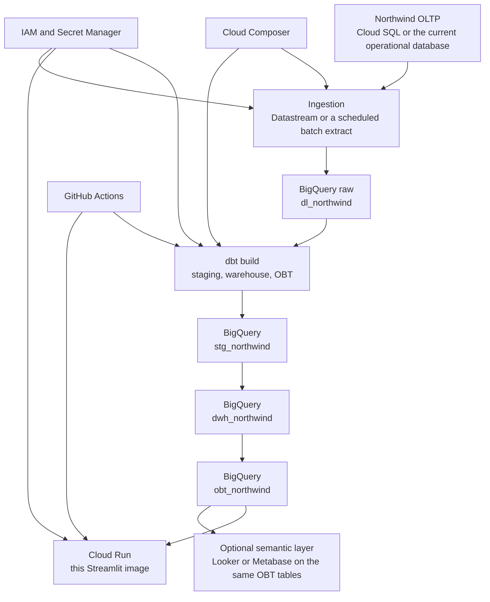
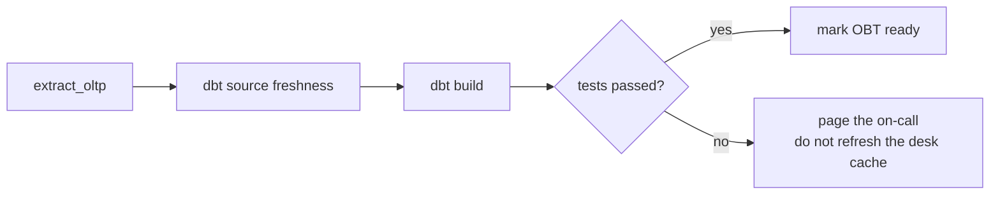

# Productionizing the Northwind warehouse

The laptop stack is a faithful small copy of the layering: raw landing zone, staging, star schema, OBT, desk. It is not the production system. Postgres in Compose is the stand-in for BigQuery. The password `analytics` is a demo default. The seed is a 2006 sample, loaded once into a Docker volume.

This is the order of work to make the same models something the company can run on.

## 1. Split environments before anything else

`profiles.yml` still defaults to the `dev` BigQuery output and the project `mlops-zoomcamp-360507`. That project should not be production.

- Create separate GCP projects, or at least separate datasets, for dev, CI, and prod.
- Point `dev` at the dev project. Add a `prod` output that Composer uses. Do not give developers prod write access.
- Decide the schema names on purpose. Today the BigQuery target prefixes them (`curated_zone_stg_northwind`). The local target does not (`stg_northwind`), which is what the desk expects. `ae_prototype/macros/generate_schema_name.sql` is the switch. Pick one convention and use it in dev, CI, and prod.
- Remove the demo password from any profile that is not the local Docker target. Local can keep reading `POSTGRES_PASSWORD`. Cloud targets should not have a password in the file at all.

## 2. Ingest from the operational database, on a schedule

The SQL file in `docker/postgres/init/` is a one-time sample. Production needs a repeating extract into `dl_northwind` and nothing else. dbt should not read the OLTP database.

- If the operational system moves to Cloud SQL, Datastream can replicate the tables into BigQuery.
- If it stays where it is, a batch job (Cloud SQL export, or a small Dataflow / Spark job) should land full or incremental snapshots in `dl_northwind`.
- Add `loaded_at` on the raw tables. The staging models already add `ingestion_timestamp` at transform time, which is not the same thing as when the row arrived.
- Add dbt source freshness in `models/sources/sources.yml` once `loaded_at` exists, and fail the Composer task when the extract is late.
- Keep the raw dataset append-only or snapshot-by-load-date. Do not let analysts create tables there.

## 3. Orchestrate the real pipeline in Composer

Compose already encodes the order: land data, `dbt run`, `dbt test`, then serve. A Composer DAG should do the same thing and then stop.

- One DAG. Tasks: extract, freshness, `dbt build` (run and test together), then a lightweight check that the three OBT tables grew or at least stayed non-empty.
- `dbt test` already fails when `obt_sales_overview`, `obt_customer_reporting`, or `obt_product_inventory` has zero rows, and when `dim_customer.customer_id` is not unique. Keep that gate in prod.
- On test failure, do not restart the desk against a half-built schema. dbt's transaction behavior on BigQuery is per statement. Run the job into a staging dataset and swap, or use a tagged release dataset, if a failed run must not be visible.
- Retire the idea of generating reports from the OLTP database. The desk, and any other BI tool, reads the OBT dataset only. That is the same rule `dashboard/data.py` follows locally.

## 4. Fix the grains before anyone trusts the money

The desk works around two model facts. They should be fixed in dbt, not left as dashboard special cases.

- `fact_purchase_order` joins purchase lines to every sales order line for the same product, then keeps a row per customer. `obt_customer_reporting` inherits that fan-out. Header fields (`payment_amount`, `shipping_fee`, `taxes`) repeat. The desk dedupes in `dashboard/metrics.py` before it sums cost. Move that rule into the model: one row per purchase-order detail id, and a separate bridge if you still need "customers who bought this product."
- `fact_inventory` stores a positive quantity. Direction is `transaction_type` (`1` purchased, `2` sold, `3` on hold, `4` waste), looked up in `inventory_transaction_types`, which is staged and then unused. Join the type name in `fact_inventory` or `obt_product_inventory`, and add a signed quantity column so a report cannot accidentally sum purchases and sales together.
- `fact_sales` partitions by `shipper_id` twice and has no `order by` on `row_number()`. Add a stable `order by` (the order-detail id, once it is on the fact) so deduping picks the same row every run.
- `dim_date` is built and never joined. Join it to `order_date`, `creation_date`, and `transaction_created_date` if you want a calendar that is not computed in the desk.
- Several staged tables never reach a fact: invoices, shippers, order statuses, privileges, strings. Either use them (shipper on `fact_sales` is the obvious one) or stop staging them until a report needs them.

## 5. Put the desk somewhere with an identity

The Streamlit image in `dashboard/` is the UI. It speaks Postgres today (`dashboard/data.py`). Production BigQuery needs a second reader behind the same three table names, selected with an environment variable, not a rewrite of the pages.

- Deploy the existing image to Cloud Run. Set `OBT_SCHEMA` to the prod OBT dataset name once the reader can talk to BigQuery.
- Put the service account key, or better Workload Identity, in Secret Manager. The Cloud Run runtime service account gets `roles/bigquery.dataViewer` on the OBT dataset and nothing on raw.
- Put Identity-Aware Proxy or Cloud Run IAM in front of the service. There is no login on the local desk, and there should not be a shared password in production.
- Customer and employee emails, phones, and addresses are on `obt_sales_overview` because the model selects the whole dimension. The sales desk does not need them. Drop those columns in the OBT, or mask them, before a wide audience can query the table.
- Replace `select *` in `dashboard/data.py` with the column list already declared there, so a new personal-data column does not silently appear in the app.
- Looker or Metabase can sit on the same three tables if the company wants a semantic layer. They should not get a second copy of the business logic. Revenue is `quantity * unit_price * (1 - discount)`. On hand is purchased minus sold minus waste.

## 6. CI that runs before merge

- GitHub Actions, on pull request: `dbt build` against the CI dataset (or the Compose stack, which is slower but does not need GCP), plus `python dashboard/test_metrics.py`, plus a Docker build of `dashboard/` and `docker/dbt/`.
- Slim CI (`dbt build --select state:modified+`) once the artifact bucket exists.
- A formatter and a linter for SQL (`sqlfluff`) so the next dialect break is caught in review. The Postgres port already removed trailing commas and `select * except`, which BigQuery accepts and Postgres does not.
- Require the OBT row-count tests to pass. Do not merge a model change that empties a desk table.
- Build the dashboard image from the same commit the dbt job deployed. A desk from Monday and models from Thursday will fail the column check, which is better than a silent blank chart, but CI should make that rare.

## 7. Warehouse hygiene

- Facts are already partitioned by date on BigQuery. Cluster `fact_sales` by `customer_id, product_id` and `fact_inventory` by `product_id` when the tables leave sample size.
- Materialize the OBT tables as tables, which they already are. Do not point a BI tool at the views underneath.
- Add snapshots (`ae_prototype/snapshots/` is empty) for customer, employee, and product if the business wants history when a company changes city or a product is discontinued. The current dimensions are "latest row wins."
- Extend tests beyond "not empty": unique fact grains, relationships from facts to dimensions, and accepted values for `transaction_type` and `discontinued`.
- Document the grains in `models/analytics_obt/schema.yml` and keep them in sync with the desk captions. The schema file is the start of that.

## 8. Watch it

- Ship dbt artifacts to GCS from the Composer run.
- Alert when source freshness fails, when an OBT row count drops by more than a chosen ratio, and when Cloud Run error rate rises.
- The local desk logs are container logs. In prod, send Cloud Run request logs and Composer task logs to one place and give them a dashboard of their own.
- Cost: the sample is tiny. A `select *` over a growing OBT, pulled into the app every minute, will not be. Cache aggregated results, or query summaries, and keep partition filters on the date columns the desk already uses.

## What stays true in production

The layering does not change. Sources land in raw. Staging is one model per source. The star schema is the warehouse. The OBT tables are the only thing a report should read. The desk is a client of those tables, not a second transformation layer. Compose proved that sequence on a laptop. Composer, BigQuery, and Cloud Run are the same sequence with an identity, a schedule, and a warehouse that is not a Docker volume.
