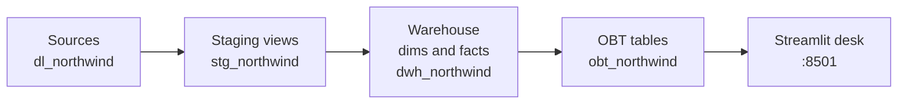
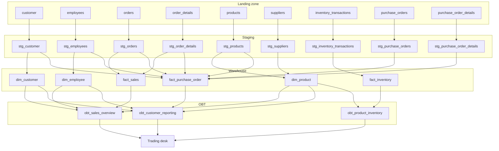
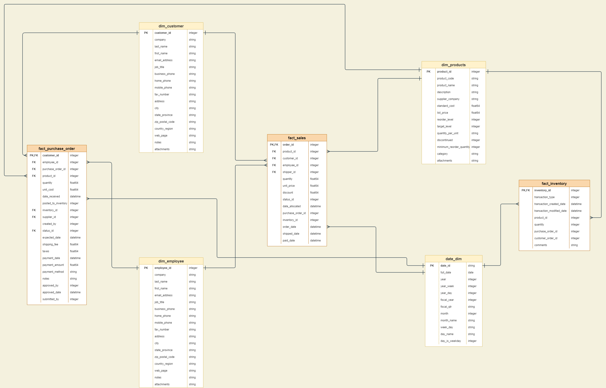
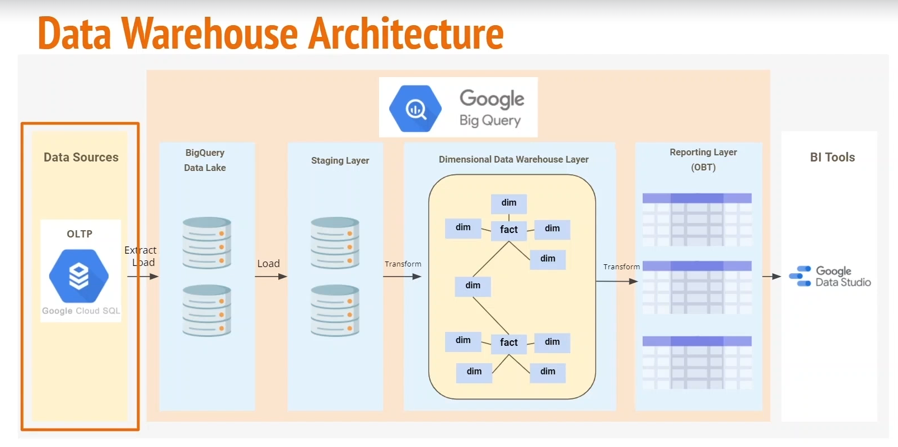
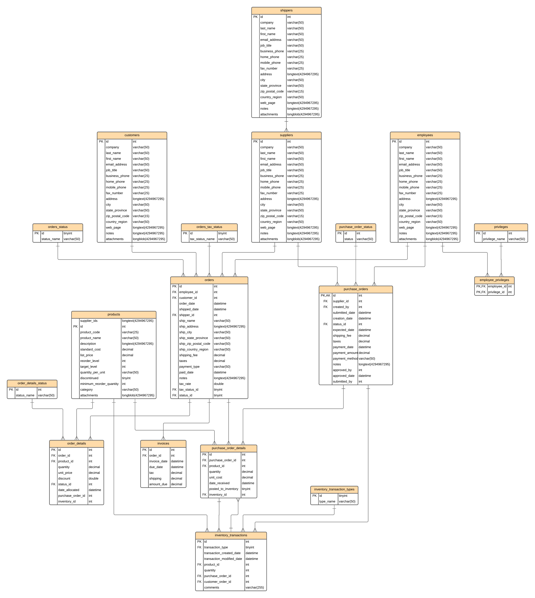

<p align="center"></p>

# Northwind trading desk

A specialty-food importer is tired of running reports on the same database that takes the orders. This repo is the analytics path that gets those reports off the operational system: land the extract, stage it, build a star schema, publish three one-big-table models, and open a desk a person can actually click.

You can run the whole path on a laptop. Docker Compose loads a Postgres warehouse with the Northwind seed, `dbt` builds the models, and a Streamlit desk serves sales, customer, and inventory reports from the OBT layer.

The BigQuery profile is still here for the cloud warehouse. Local development does not need a GCP login.

## Run it

You need Docker with Compose v2. From the repo root:

```bash
docker compose up --build
```

The first start pulls Postgres, installs dbt and Streamlit, loads the seed, and builds the models. When the log says the dashboard is listening, open [http://localhost:8501](http://localhost:8501).

What comes up:

| Piece | Where | What it does |
| --- | --- | --- |
| Postgres 16 | `localhost:5432` | Warehouse. User `analytics`, password `analytics`, database `northwind`. Demo values only. |
| dbt 1.9 | one-shot container | `dbt run` then `dbt test` against the `local` target. Exits when the build is good. |
| Trading desk | [http://localhost:8501](http://localhost:8501) | Streamlit. Reads only `obt_northwind`. |

The desk has four views:

- **Overview** — net sales, order count, purchase cost, and products under their reorder level.
- **Sales** — `obt_sales_overview`. Revenue by month, product, seller, and customer.
- **Customers** — `obt_customer_reporting`. Purchase lines linked to customers who bought those products.
- **Inventory** — `obt_product_inventory`. On-hand stock, movements, and reorder gaps.

The sample orders are from 2006. The date filter opens on the full range in the warehouse, not "the last 30 days," or every chart would be empty.

Leave it running in that terminal, or start it in the background:

```bash
docker compose up --build -d
```

Watch the build if you want the play-by-play:

```bash
docker compose logs -f dbt
docker compose logs -f dashboard
```

Stop it, and wipe the warehouse volume when you want a clean seed:

```bash
docker compose down
docker compose down -v
```

### After you change a model

The dbt service exits when it finishes, so a second `up` will not rebuild unless you recreate it.

```bash
docker compose up -d --force-recreate --build dbt
```

Then click **Reload warehouse** on the desk. The app also refreshes its cache every 60 seconds.

Check the tables yourself:

```bash
docker compose exec postgres psql -U analytics -d northwind -c \
  "select 'sales' as model, count(*) from obt_northwind.obt_sales_overview
   union all select 'customers', count(*) from obt_northwind.obt_customer_reporting
   union all select 'inventory', count(*) from obt_northwind.obt_product_inventory;"
```

### Run the desk math without Docker

The stock and revenue math has a small local check. It does not need the database:

```bash
pip install pandas
python dashboard/test_metrics.py
```

## How the pieces fit



Locally, Compose is the orchestrator. Postgres loads `docker/postgres/init/01_dl_northwind.sql` the first time the volume is empty. dbt waits until Postgres is healthy, builds every model, runs the tests, and only then does the desk start. If `dbt test` fails, the desk stays down. That is deliberate.

On the BigQuery `dev` target, dbt still prefixes custom schemas with the target dataset (`curated_zone_stg_northwind`, and the same for the warehouse and OBT). The `local` target does not prefix them, so the desk can use `stg_northwind`, `dwh_northwind`, and `obt_northwind` as written. See `ae_prototype/macros/generate_schema_name.sql`.

## Lineage

Most staging models are a clean pass-through of one source table, plus an `ingestion_timestamp`. A few of those pass-throughs (statuses, privileges, invoices, strings, shippers) are staged and not yet joined into a fact. `dim_date` is built and not yet joined either. The diagram below is the lineage that actually feeds the desk.



Grains, because they change how you read the numbers:

- **Sales.** One row per deduplicated order line. Net revenue is `quantity * unit_price * (1 - discount)`. In this seed the discount is 0, and the formula still honors a fraction when one shows up. Products that list more than one supplier are still left out of `dim_product`. Their sales lines stay on the fact, and the desk labels them with the product id.
- **Customers.** One purchase line can appear once per customer who bought that product. The desk counts money on a deduplicated purchase line so that fan-out is not summed twice. What a customer paid for an order lives on the Sales page.
- **Inventory.** One row per transaction. Quantity is always a positive count. Type `1` is purchased, `2` sold, `3` on hold, `4` waste. On hand is purchased minus sold minus waste.

## The business this is for

Northwind Traders buys and sells specialty food. The operational database records the sales, and someone also uses it for reporting. Reporting load slows the system people need to take orders. The goal of the warehouse is:

1. Scale reporting without scaling the operational database.
2. Keep that load off the transactional system.
3. Make the reports fast.
4. Tighten who can see customer and employee details.

The operational extract lands in a raw schema (`dl_northwind` locally, the same name in BigQuery). dbt never writes back to it.

### Reports we owe the business

- **Sales overview.** What is selling, where, and which products are quiet.
- **Sales agent tracking.** Who is selling, so commissions and coaching have a source.
- **Product inventory.** What is on hand, who supplies it, and what we are buying.
- **Customer reporting.** Which customers sit behind which purchase orders, and what those orders cost.

### How the dimensional model was built

1. Pick the process: sales, purchasing, inventory.
2. Declare the grain: an order line, a purchase line, an inventory transaction.
3. Name the dimensions: customer, employee, product, date.
4. Name the facts: the counts and money those processes produce.



A dimensional model is a denormalized warehouse shape, built for retrieval rather than for taking orders. Ralph Kimball's name for the usual layout is a star schema: a fact in the middle, dimensions around it. The OBT models are a second serving layer. They pre-join the star into a wide table so a report does not have to.



The operational diagram the extract comes from:



## Project layout

```text
ae_prototype/                 dbt project
  models/sources/             landing-zone tables
  models/staging/             cleaned views, one per source
  models/warehouse/           dimensions and facts
  models/analytics_obt/       the three tables the desk reads
  macros/generate_schema_name.sql
  tests/                      the OBT tables must be non-empty
dashboard/                    Streamlit app
docker/postgres/init/         seed loaded on first Postgres start
docker/dbt/                   image that runs dbt
docker-compose.yml            postgres, then dbt, then the desk
profiles.yml                  BigQuery dev target and Postgres local target
PRODUCTIONIZING.md            what to do before this is a real environment
```

## Walk the implementation

1. **Land the extract.** `docker/postgres/init/01_dl_northwind.sql` creates schema `dl_northwind` and loads the Access 2010 Northwind sample. The MySQL conversion those rows came from is Dale Scott's [MyWind](https://github.com/dalers/mywind) project. The table `customers` is renamed to `customer` so it matches the dbt source, which is the singular name already used in BigQuery (`dl_northwind.customer`).
2. **Stage it.** Each file in `models/staging` selects from one source and stamps `ingestion_timestamp`. `stg_products` casts `supplier_ids` to an integer and drops products that list more than one supplier (`2;6` and friends). That rule was already in the model.
3. **Build the star.** Dimensions dedupe to one row per business key. Facts dedupe with `row_number()`. Facts are tables. Dimensions and staging are views. On BigQuery the facts are date-partitioned. That config is BigQuery-only, because Postgres rejects it.
4. **Publish the OBTs.** `obt_sales_overview`, `obt_customer_reporting`, and `obt_product_inventory` are tables in `obt_northwind`. They are the only relations the desk queries.
5. **Serve the desk.** `dashboard/app.py` loads those three tables and computes revenue, purchase cost, and on-hand stock in `dashboard/metrics.py`.
6. **Orchestrate.** `docker-compose.yml` runs the steps in order. A failed test stops the desk from starting.

Models are written so the same SQL compiles on Postgres and on BigQuery. The date dimension is the exception: `dim_date.sql` has a branch per warehouse, because `generate_date_array` is BigQuery and `generate_series` is Postgres.

## Profiles

`profiles.yml` has two outputs.

- `dev` is BigQuery, project `mlops-zoomcamp-360507`, dataset `curated_zone`, oauth. It is the default, so a plain `dbt run` on a machine with GCP credentials still aims at BigQuery.
- `local` is Postgres. Compose sets `DBT_TARGET=local` and points the host at the `postgres` service.

To build against a Postgres on your machine instead of in Compose:

```bash
export DBT_TARGET=local
export DBT_PROFILES_DIR="$PWD"
cd ae_prototype
dbt run --target local
dbt test --target local
```

Postgres has to already contain the `dl_northwind` seed. Compose is the supported way to get there.

## Tests

`dbt test` checks that `dim_customer.customer_id` is unique and not null, and that each OBT table has at least one row. Compose runs that before the desk starts.

## Where this goes next

Local Compose is a development loop, not a production warehouse. [PRODUCTIONIZING.md](PRODUCTIONIZING.md) is the concrete list: ingestion off the OLTP system, Composer, CI, a real identity on the desk, and the grain fix the customer report still needs.

## Credits and further reading

- Northwind is Microsoft's sample company. The seed in this repo adapts Dale Scott's MyWind conversion and keeps that project's license notice in the SQL file.
- dbt docs: [https://docs.getdbt.com/docs/introduction](https://docs.getdbt.com/docs/introduction)
- dbt community: [https://community.getdbt.com/](https://community.getdbt.com/)
